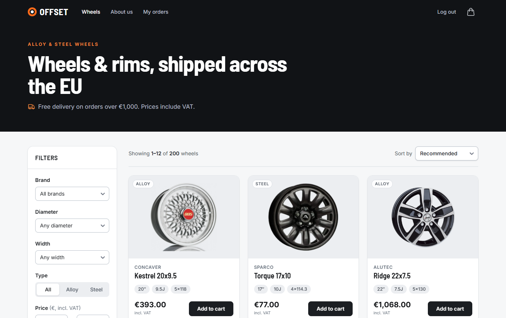
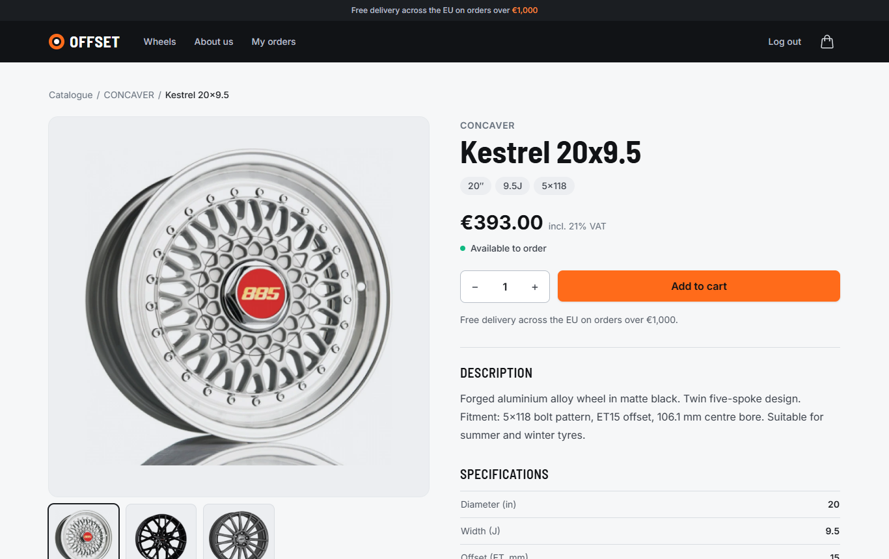
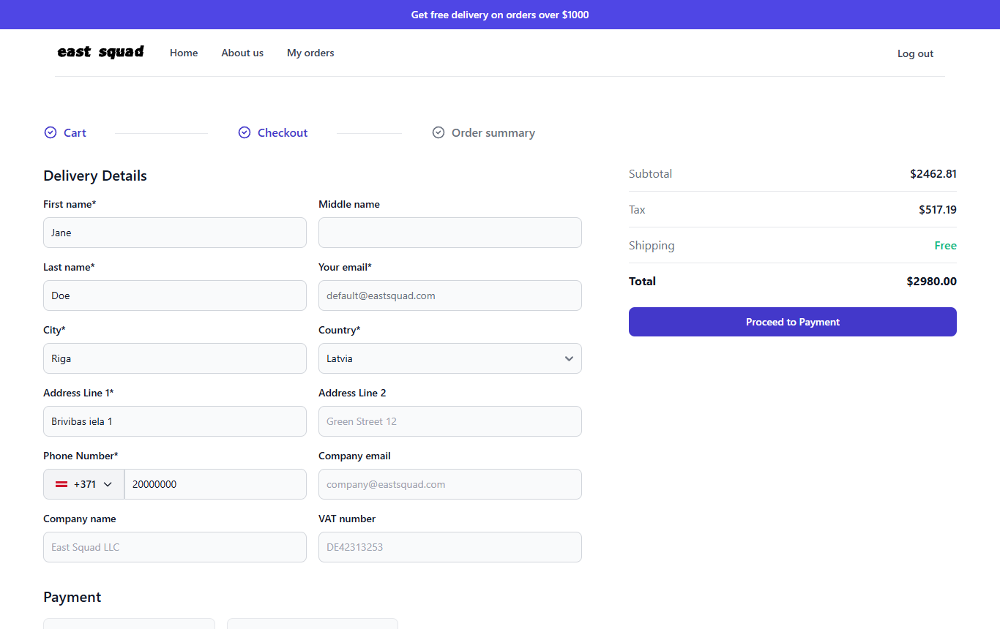
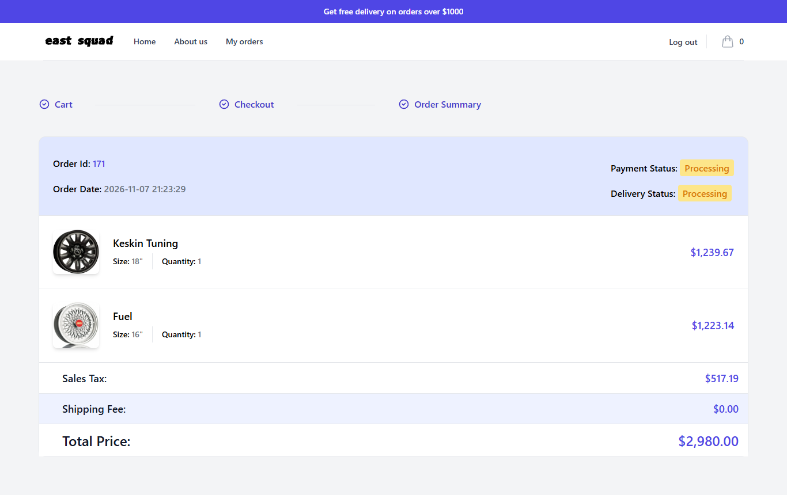
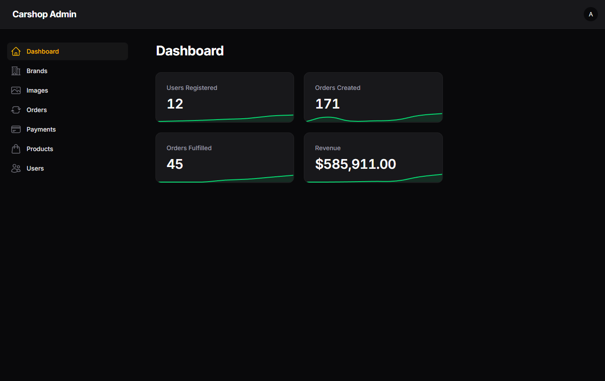
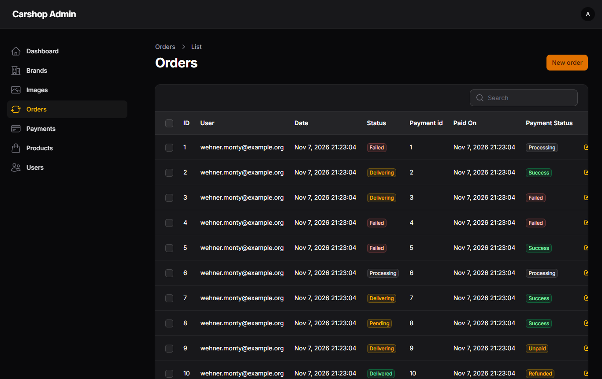

# Carshop – wheel & rim web shop

[](https://github.com/Bracka1337/carshop-api/actions/workflows/ci.yml)

An e-commerce shop for car wheels and rims, built with Laravel. Customers
browse the catalogue, filter by wheel specs (diameter, width, type, brand,
price), add rims to a cart and check out with pay-on-delivery or a (simulated)
card payment. Staff manage brands, products, images, orders, payments and
users in a Filament admin panel. A small token-authenticated JSON API exposes
the catalogue and a customer's orders.

## Screenshots

| Catalogue | Product details |
| --- | --- |
|  |  |
| **Checkout** | **Order details** |
|  |  |
| **Admin dashboard** | **Admin orders** |
|  |  |

## Background

This started as a team project at the **Magebit Summer Bootcamp 2024**: a team
of five built the shop, and I was the **team lead**. Our team won **first
place**. The commit history includes everyone's work.

In 2026 I upgraded and refactored the project on my own:

- Laravel 10 → 11 → 12 → 13 and Filament 3 → 4, following the official upgrade guides
- removed the committed `vendor/` directory and build output from git
- updated PHP and JS dependencies until `composer audit` and `npm audit` were clean
- replaced the unused Passport setup with Sanctum and a small read-only JSON API
- reorganised checkout into actions, an order policy, status enums and Form
  Requests, with thin controllers
- fixed bugs found along the way: access control on order details and card
  payments, order totals that followed later price changes, two different
  shipping rules, state changes over GET, 500s on malformed input, and a
  production asset build that broke every page
- added feature tests, Larastan at level 8, Eloquent strict mode and CI

## Stack

| Layer      | Tech                                                         |
| ---------- | ------------------------------------------------------------ |
| Backend    | PHP 8.3+, Laravel 13, Eloquent, Blade                        |
| Admin      | Filament 4 (Livewire 3)                                      |
| API auth   | Laravel Sanctum personal access tokens                       |
| Frontend   | Vite 8, Tailwind CSS 3, Flowbite                             |
| Database   | MySQL (Docker) or SQLite (local)                             |
| Tests      | PHPUnit 12, Laravel HTTP & Livewire testing, ParaTest        |
| Quality    | Larastan (PHPStan level 8), Pint, GitHub Actions CI          |
| Infra      | Docker Compose: PHP-FPM, nginx, MySQL                        |

## Features

- **Catalogue**: paginated listing, filters by diameter / width / type / brand /
  price range, sorting by price or brand
- **Product pages**: `/products/{slug}` with a photo gallery, spec table,
  quantity, four similar wheels (same diameter and bolt pattern), and title,
  meta description and Open Graph tags; slugs are made from the title and
  stay fixed when it is edited
- **Cart**: session based; add, change quantity, remove
- **Checkout**: delivery details form, pay on delivery or a simulated card
  payment, order + payment records; each order line keeps the unit
  price paid, so later price changes don't alter past orders; a declined card
  returns to the card form with an error and can be retried
- **Shipping**: 10% of the items total below 1000, free from 1000; one
  `ShippingCalculator` used by checkout and saved orders, configured in
  `config/shop.php` (`SHOP_SHIPPING_RATE`, `SHOP_FREE_SHIPPING_FROM`)
- **VAT**: prices include 21% VAT (`SHOP_VAT_RATE`). Checkout, order pages and
  the API show the same breakdown: subtotal without VAT + VAT + shipping = total
- **Currency**: euros by default; code and symbol in `config/shop.php`
  (`SHOP_CURRENCY`, `SHOP_CURRENCY_SYMBOL`), used by shop pages, admin and API
- **Accounts**: registration, login, profile with order history and order details
- **Admin panel** (`/admin`, admin role only): CRUD for brands, products,
  images, orders, payments and users, plus dashboard stats (users, orders,
  fulfilled orders, revenue)
- **JSON API**: products (public), current user and own orders (token)

## Architecture

A Blade shop with a Filament admin panel; the JSON API is a small read-only
extra. Controllers stay thin: they validate with a Form Request, check access
with a policy and hand the work to an action or service.

```
request ─▶ Form Request ─▶ controller ─▶ policy (OrderPolicy)
                                  └────▶ action (PlaceOrder, PayOrderByCard)
                                              └──▶ Eloquent models ─▶ DB
```

- **Actions** (`app/Actions/Checkout`): `PlaceOrder` turns the session cart into
  delivery details, a payment and order lines in one database transaction,
  storing each line's unit price. It rejects an empty cart or products that are
  no longer sold before writing anything. `PayOrderByCard` simulates the
  card charge (or sends it to `PAYMENT_ENDPOINT` through Laravel's HTTP client
  when that is set) and records the result on the payment and the order.
- **Policies** (`app/Policies/OrderPolicy`): `view` lets customers see only
  their own orders, on the web and in the API; other ids are a 404, so they
  can't be probed. `pay` allows a card payment only for the customer's own
  unpaid (or declined) order.
- **Enums**: `OrderStatus` and `PaymentStatus` are backed by the stored strings
  and carry their admin badge colours and shop badge classes.
- **Totals**: `TotalsCalculator` works out the VAT included in prices and uses
  `ShippingCalculator`, the one shipping rule (rates and threshold in
  `config/shop.php`). The checkout summary in `CartService` and
  `Order::costBreakdown()` for saved orders both go through it.
- **Sanctum API** (`routes/api.php`, `app/Http/Controllers/JsonApi`): personal
  access tokens from `POST /api/login`; products are public, `/api/user` and
  `/api/orders` need a token. Responses go through API resources, and orders
  use the same `OrderPolicy` as the shop.
- **Filament admin** (`app/Filament`, `/admin`): resources for brands, products,
  images, orders, payments and users, plus dashboard widgets. Only users with
  the `Admin` role can open the panel (`User::canAccessPanel`).

## Running locally (SQLite)

Requirements: PHP 8.3+ (with `pdo_sqlite`, `intl`, `zip`, `mbstring`),
Composer 2, Node.js 20.19+ or 22.12+.

```bash
composer install
npm ci
npm run build            # or `npm run dev` while working on the frontend

cp .env.example .env
php artisan key:generate
```

Switch the database to SQLite in `.env`:

```dotenv
DB_CONNECTION=sqlite
# comment out or remove DB_HOST, DB_PORT, DB_DATABASE, DB_USERNAME, DB_PASSWORD
```

Then create the schema, demo data and the public storage link (product images
live in `storage/app/public/images`):

```bash
php artisan migrate --seed     # offers to create database/database.sqlite
php artisan storage:link
php artisan serve
```

Open http://127.0.0.1:8000.

## Running with Docker

`docker-compose.yml` starts three containers: `app` (PHP 8.3-FPM + Node 22),
`nginx` on port **8080** and `mysql-db` (MySQL 5.7). The project directory is
mounted into the containers, so dependencies are installed into your working
copy:

```bash
cp .env.example .env           # already points at DB_HOST=mysql-db
docker compose up -d --build

docker compose exec app composer install
docker compose exec app sh -c "npm ci && npm run build"
docker compose exec app php artisan key:generate
docker compose exec app php artisan migrate --seed
docker compose exec app php artisan storage:link
```

Open http://localhost:8080.

## Demo accounts

The seeder creates 200 products across 54 brands, random customers with
orders, and two fixed accounts. **These are for local development only.**

| Role  | Email                   | Password  |
| ----- | ----------------------- | --------- |
| Admin | `admin@eastsquad.com`   | `admin`   |
| User  | `default@eastsquad.com` | `default` |

Seeded random customers use the password `password`. For card payments use any
future expiry date, any 3-digit CVV and a 16-digit card number such as
`4242 4242 4242 4242`; `4000 0000 0000 0002` is declined.

## Tests

```bash
php artisan test
```

Tests run against an in-memory SQLite database (see `phpunit.xml`) and cover
auth, catalogue filters, cart, checkout, card payments (with the payment
endpoint faked), malformed input, profile/order access, every Filament resource
page, product CRUD in the admin, and all API endpoints.

Static analysis runs Larastan (PHPStan) at level 8 with no baseline:

```bash
vendor/bin/phpstan analyse
```

Outside production, Eloquent runs in strict mode (`Model::shouldBeStrict()`), so
lazy loading (N+1 queries) and missing attributes fail the tests.

GitHub Actions runs Pint (`vendor/bin/pint --test`), PHPStan, the asset build
and the test suite (in parallel) on PHP 8.3 for every push to `main` and every
pull request.

## Routes overview

### Web shop (session auth)

| Method | Path                           | Description                                   |
| ------ | ------------------------------ | --------------------------------------------- |
| GET    | `/`                            | Catalogue with filters (`diameter`, `width`, `type`, `brand`, `price_from`, `price_to`, `order`) |
| GET    | `/products/{slug}`             | Product page with specs and similar wheels    |
| GET    | `/aboutus`                     | About the team                                |
| POST   | `/cart/add/{id}`               | Add a product to the cart                     |
| POST   | `/cart/update/{id}/{quantity}` | Change quantity (0 removes the item)          |
| POST   | `/cart/remove/{id}`            | Remove from cart (JSON response)              |
| GET    | `/register`, `/login`          | Auth pages (POST to submit)                   |
| POST   | `/logout`                      | Log out                                       |
| GET    | `/profile`                     | Order history *(auth)*                        |
| GET    | `/profile/orderdetails/{order}`| One of your orders *(auth)*                   |
| GET    | `/checkout`                    | Delivery details form *(auth)*                |
| POST   | `/payment`                     | Create the order *(auth)*                     |
| GET    | `/payment-details`             | Card form for an unpaid order *(auth)*        |
| POST   | `/process-payment`             | Pay by card (simulated) *(auth)*              |
| GET    | `/admin`                       | Filament admin panel *(admin role)*           |

### JSON API (`/api`, Sanctum tokens)

All responses are JSON. Protected endpoints need an
`Authorization: Bearer <token>` header.

| Method | Path                  | Auth  | Description                                       |
| ------ | --------------------- | ----- | ------------------------------------------------- |
| POST   | `/api/login`          | –     | `email`, `password`, optional `device_name` → token (rate limited: 6/min) |
| POST   | `/api/logout`         | token | Revoke the token used for the request             |
| GET    | `/api/user`           | token | Current user                                      |
| GET    | `/api/products`       | –     | Paginated products; same filters as the shop      |
| GET    | `/api/products/{id}`  | –     | One product with brand, specs and image URLs      |
| GET    | `/api/orders`         | token | Your orders with items and totals                 |
| GET    | `/api/orders/{id}`    | token | One of your orders (others return 404)            |

Example:

```bash
TOKEN=$(curl -s -X POST http://127.0.0.1:8000/api/login \
  -d email=default@eastsquad.com -d password=default -d device_name=cli \
  | php -r 'echo json_decode(stream_get_contents(STDIN))->token;')

curl -s "http://127.0.0.1:8000/api/products?diameter=17&order=price_asc"
curl -s -H "Authorization: Bearer $TOKEN" http://127.0.0.1:8000/api/orders
```

`GET /api/products/1` (trimmed):

```json
{
  "data": {
    "id": 1,
    "title": "Ronal",
    "brand": { "id": 44, "title": "Ronal" },
    "type": "Alloy",
    "price": 980,
    "specs": { "diameter": 19, "width": 10.5, "et": 5, "cb": 56, "bolt": 5, "bolt_diameter": 108 },
    "images": ["http://127.0.0.1:8000/storage/images/Borbet.webp", "…"]
  }
}
```

## Project layout

```
app/Actions/Checkout/          PlaceOrder, PayOrderByCard
app/Enums/                     OrderStatus, PaymentStatus (badge colours included)
app/Filament/                  Admin panel resources, pages and widgets
app/Http/Controllers/Web/      Web shop controllers (Blade views, session auth)
app/Http/Controllers/JsonApi/  JSON API controllers (Sanctum)
app/Http/Requests/             Form Requests for every write route
app/Http/Resources/            API resources (Product, Order, User)
app/Models/                    Eloquent models (Order, OrderLine, DeliveryDetail, Payment, Product, …)
app/Policies/                  OrderPolicy (view, pay)
app/Services/                  CartService (session cart), TotalsCalculator, ShippingCalculator
resources/views/               Blade templates
tests/Feature/                 Web, Admin and Api feature tests
tests/Unit/                    TotalsCalculator, ShippingCalculator
```

## Known limitations

- No real payment provider is integrated. Card payments are simulated: any
  valid card is approved except the test card `4000 0000 0000 0002`, which is
  declined. Setting `PAYMENT_ENDPOINT` sends the card to an HTTP endpoint that
  answers `{"status": "success"}` to approve.
- Shipping on saved orders is recalculated from the current shipping config;
  only the unit prices are stored per order.
- There is no stock tracking: every product page says "Available to order".
